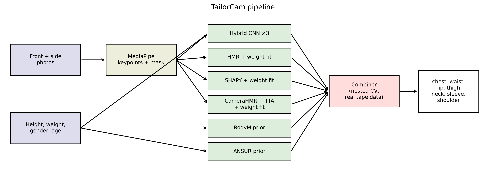
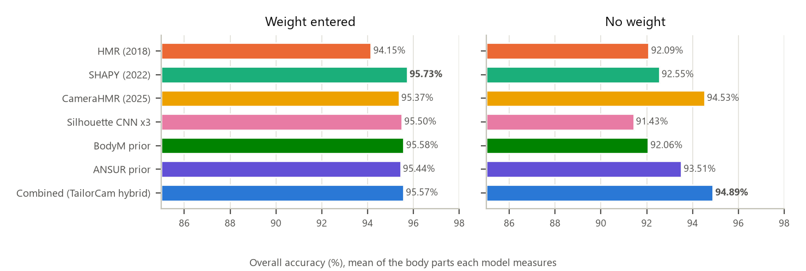
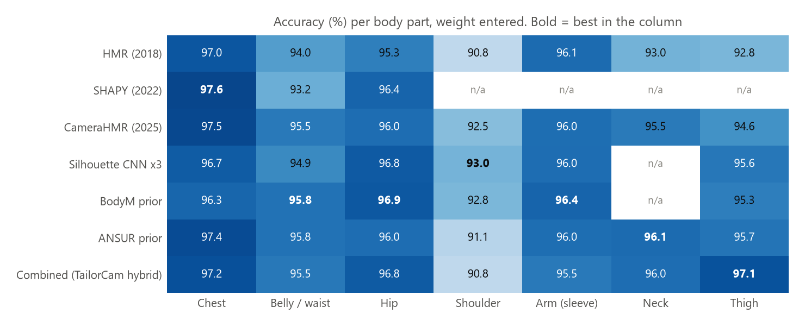

# TailorCam

**Body measurements for tailor shops from two photos.** The customer stands in front of a webcam (or two photos are
uploaded), enters their height and, if known, their weight, and TailorCam gives chest, waist, hip, neck, thigh,
shoulder and sleeve measurements, clothing sizes and a 3D body. Every value is marked *Camera OK* or *Check with tape*.

Capstone project (CSE400), Department of Computer Science and Engineering, East West University, Dhaka.
**Author:** Md Ashikuzzaman (2022-3-60-101) · **Supervisor:** Dr. Mohammad Mahdi Hasan

---

## How it works



1. **Photo step.** MediaPipe finds the body points and the person outline in the front and side photo.
2. **Six models** each estimate the measurements:
   - **HMR** (2018), **SHAPY** (CVPR 2022) and **CameraHMR** (3DV 2025) build a 3D body, which is resized to the
     customer's real height and weight and measured with a virtual tape;
   - a **silhouette CNN** (3 ResNet-18 copies, trained on Amazon BodyM) reads the front and side outline;
   - two **height-and-weight models** (BodyM prior, ANSUR II prior) work without any photo.
3. **Combiner.** For each body part a learned rule decides which model to trust and how much to correct it. It is
   trained on real tape-measured people.
4. **Shop offset (optional).** One correction per measurement learned from the shop's own customers, so the app
   matches how that tailor tapes.

## Results

Tested on 24 real people measured with a tape (normal clothes), with leak-free nested cross-validation:

| Weight entered | Chest | Waist | Hip | Neck | Thigh | Sleeve |
|---|---|---|---|---|---|---|
| Average error | 2.62 cm | 3.36 cm | 3.19 cm | 1.37 cm | 1.54 cm | 2.61 cm |
| Accuracy | 97.2% | 95.6% | 96.8% | 96.0% | 97.1% | 95.5% |

- Right shirt size from the chest for **83%** of people, never more than one size off.
- Without the weight: chest 3.54 cm, waist 3.93 cm, hip 5.49 cm.
- About **7 seconds** per customer on an NVIDIA RTX 4070.
- On 10 new people measured by a local tailor (one front photo, no weight): **91.8%** overall as is, **95.9%** with a shop offset.
- All 31 testable people together (24 + our own 10, no weight): TailorCam 93.8%, second only to CameraHMR alone (94.5%); the gap is the shoulder, which has no learned rule yet.




## Repository layout

```
code/                     everything the program needs
  main.py                 the desktop app
  output.py, ui_text.py   screens and text rendering
  paths.py                where datasets, model assets and shop data live
  model/                  measuring code, combiner, our trained networks
    hmr/                  HMR body model, virtual tape, measuring worker
    bodym/                silhouette CNN (BodyM)
    calibration.py        combiner and shop offset
  scripts/                build datasets, train, test, make reports
  experiments/            extra experiments
  notebooks/              paper notebooks (.py)
docs/                     images for this page
```

## Setup

```
git clone https://github.com/Ashikuzzaman17/TailorCam.git
cd TailorCam/code
pip install -r requirements.txt
python main.py
```

Some large or licensed files are not in this repository. Put them here before running:

| Needed for | Put it in | Get it from |
|---|---|---|
| CameraHMR | `code/assets/camerahmr/` | camerahmr.is.tue.mpg.de |
| SHAPY and SMPL-X | `code/assets/shapy/` | shapy.is.tue.mpg.de |
| SMPL body model (HMR, CameraHMR) | `code/model/smpl_weights/`, `code/model/hmr/smpl_hmr.npz` | smpl.is.tue.mpg.de |
| HMR network weights | `code/model/hmr/hmr_weights.pt` | convert the original HMR checkpoint with `python model/hmr/convert_weights.py` |
| Silhouette CNN weights | `code/model/bodym/bodym_hybrid_s0.pt`, `_s1`, `_s2` | train with `python model/bodym/train_bodym.py` on Amazon BodyM |
| Training and test data | `dataset/` next to `code/` | BodyM, ANSUR II, HBW, BEDLAM, BODY-fit, NOMO-3D (links in the project report) |

The app still runs without CameraHMR or SHAPY; it then uses the remaining models. `code/paths.py` explains how to
keep the datasets on another drive.

## Adapting to a shop

1. Scan customers as usual and enter the real tape values with the **Feedback** button.
2. After 5 or more customers, run `python scripts/retrain_from_shop.py`.

The app then corrects only the body parts where this lowered the error. Delete
`code/model/calibration/shop_offset.json` to switch it off.

## Licence

Copyright (c) 2026 Md Ashikuzzaman. All rights reserved. The code is public so it can be read and reviewed; it is
not open source. See [LICENSE](LICENSE).

The trained network weights and all data are not included. SMPL, SMPL-X, HMR, SHAPY, CameraHMR and most of the
datasets are for non-commercial research only and are covered by their owners' licences. MediaPipe's
`pose_landmarker.task` is included under the Apache License 2.0.
